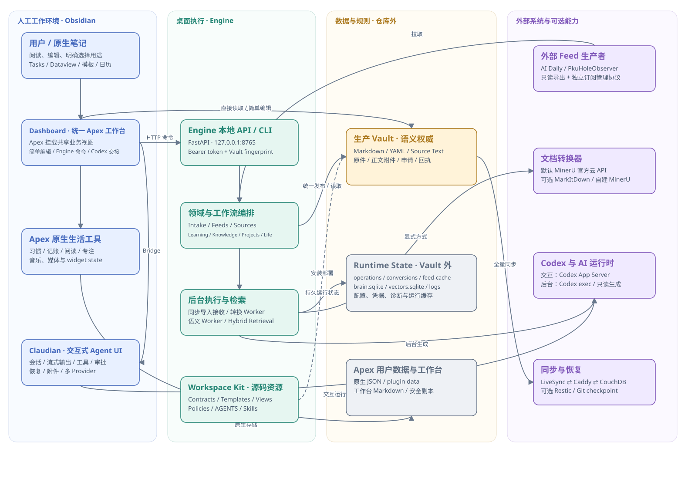

# OKF Workspace

以 Obsidian Vault 为中心的个人工作空间。Markdown/YAML 保存长期语义，Engine 负责确定性操作与后台任务，Dashboard 提供工作台，Claudian 提供内嵌 Codex 会话。

## 信息流与架构图

[打开交互式信息流与架构图](docs/architecture/visualizations/index.html)：默认沿分支查看信息入口、用户选择、处理、保存位置与后续复用；其他标签展示系统组成、模块依赖、数据归属、文件导入、AI 执行和部署同步。页面离线可用，节点提供现行文档与代码引用。

[](docs/architecture/visualizations/index.html#overview)

图是架构的解释视图，规范正文见[架构文档](docs/architecture/README.md)。下载仓库后可在浏览器打开 HTML；仓库中的文件不代表已经部署了在线站点。

## 仓库结构

| 目录 | 职责 |
| --- | --- |
| `engine/` | 领域模型、导入、Feed、检索、API、Worker、CLI 与可部署 Vault 资源 |
| `dashboard/` | Obsidian 工作台、Apex 上游源码及集成层 |
| `claudian/` | 助手界面、会话与 Provider 运行时 |
| `services/` | 独立的可选 MarkItDown 服务、历史 Originals 恢复服务 |
| `integrations/` | 外部系统客户端约定与部署资产，包括自建 MinerU |
| `deploy/`、`scripts/` | 安装、构建、检查、备份与恢复工具 |
| `tests/` | 跨组件与 fixture-Vault 验证 |
| `docs/` | 现行指南、发布与历史记录 |

生产 Vault（含原件）、Runtime State、索引、会话和密钥均位于仓库外。Contracts、模板、Policies 与 Skills 保留在 `engine/workspace/`，安装时部署到 Vault。

## 开始开发

需要 Windows 11、PowerShell 7、Python 3.12、uv、Node.js 24、npm 和 Git。Obsidian 与已登录的 Codex CLI 用于本机完整流程验收。

在仓库根目录执行：

```powershell
./scripts/bootstrap.ps1
./scripts/check.ps1
./scripts/build.ps1
```

组件各自维护依赖与 lockfile，根脚本统一调度。旧 Originals 服务使用 `./scripts/check-legacy-originals.ps1` 单独检查；当前 Vault 原件迁移与旧设备上传恢复仍进入默认检查。

## 文档入口

| 文档 | 阅读目的 |
| --- | --- |
| [架构](docs/architecture/README.md) | 模块边界、依赖方向与数据归属 |
| [数据模型](docs/DATA-MODEL.md) | Artifact、YAML、用途与人工/AI 正文区域 |
| [开发与验收](docs/DEVELOPMENT.md) | 环境、构建、测试、文案与文档维护 |
| [使用指南](docs/USER-GUIDE.md) | 导入、阅读、学习、项目、剪藏与插件操作 |
| [部署运维](docs/DEPLOYMENT.md) | 安装、转换配置、同步、备份、迁移与卸载 |
| [接口与集成](docs/INTERFACES.md) | API、CLI、Feed 协议、Command IDs 与 Claudian Bridge |
| [当前计划](docs/DEVELOPMENT-PLAN.md) | 仍需推进或确认的维护事项 |

组件说明和历史证据见[文档索引](docs/README.md)。用户要求优先；Vault Artifact 格式以 Contracts 为准，模块边界以架构文档为准，历史文档仅供追溯。
