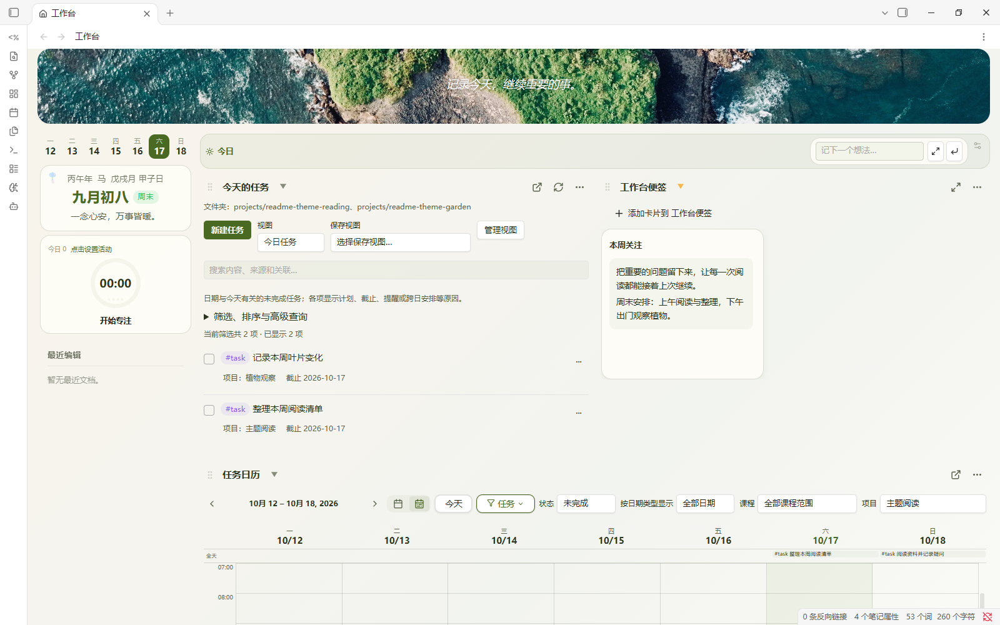
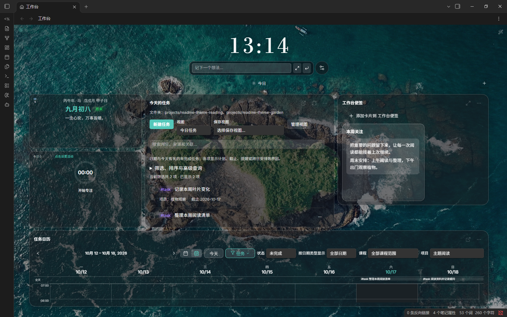
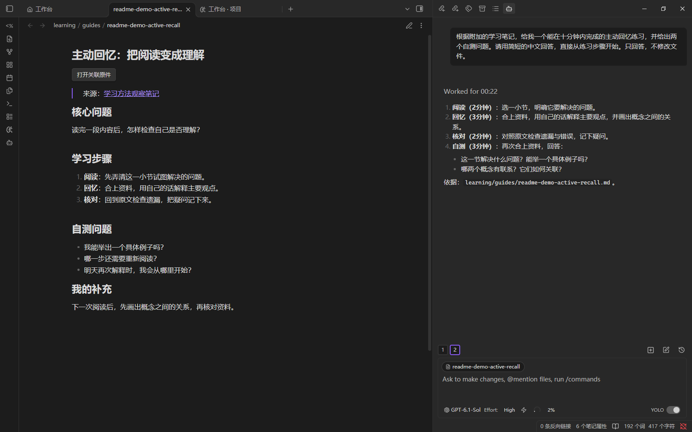
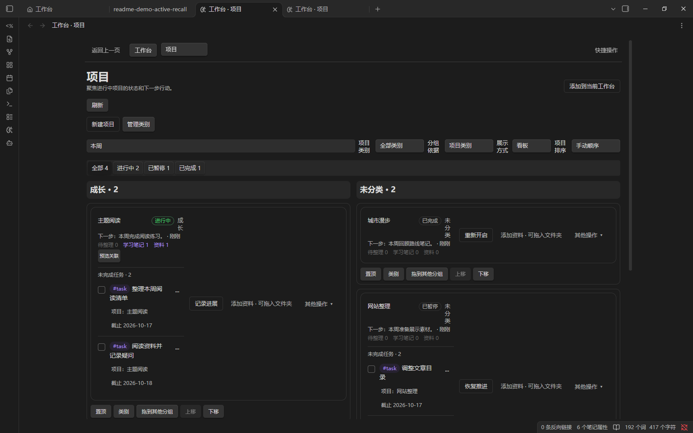

# OKF Workspace

以 Obsidian Vault 为中心的个人工作空间。Markdown/YAML 保存长期内容，Engine 负责领域操作与后台任务，
Dashboard 提供工作台，Claudian 提供内嵌 Codex 会话。

[架构与信息流](#架构与信息流) · [界面预览](#界面预览) · [文档入口](#文档入口)

## 架构与信息流

[架构说明](docs/architecture/README.md) · [交互查看器](docs/architecture/visualizations/index.html)

## 界面预览

### 工作台

#### 普通布局 · 抹茶

#### 沉浸布局 · 胶囊

### 功能片段

#### 学习笔记与会话

#### 项目看板

## 文档入口

| 文档 | 用途 |
| --- | --- |
| [使用指南](docs/USER-GUIDE.md) | 记录、任务、资料、学习、项目与工作台操作 |
| [开发与验收](docs/DEVELOPMENT.md) | 开发命令、固定测试环境、检查与验收 |
| [部署运维](docs/DEPLOYMENT.md) | 安装更新、配置、同步、迁移与恢复 |
| [架构与数据](docs/architecture/README.md) | 模块边界、数据归属与关键约束 |
| [接口与集成](docs/INTERFACES.md) | API、CLI、Feed、插件命令及 Claudian Bridge |

## 维护参考

- [Vault Contracts](engine/workspace/vault/system/contracts/README.md)：Artifact 格式权威；模板、Policies、Skills 与 Contracts 随 Engine 部署。
- 上游来源与采用边界：[Dashboard](dashboard/UPSTREAM.md)、[Claudian](claudian/UPSTREAM.md)。
- [Dashboard 验收台账](dashboard/ACCEPTANCE.md)：具名版本、产物与证据位置。

用户笔记、原件、凭据和运行状态保存在仓库外。历史设计与变更过程通过 Git 历史查阅；
实际部署状态以目标环境配置、安装文件和回执确认。
