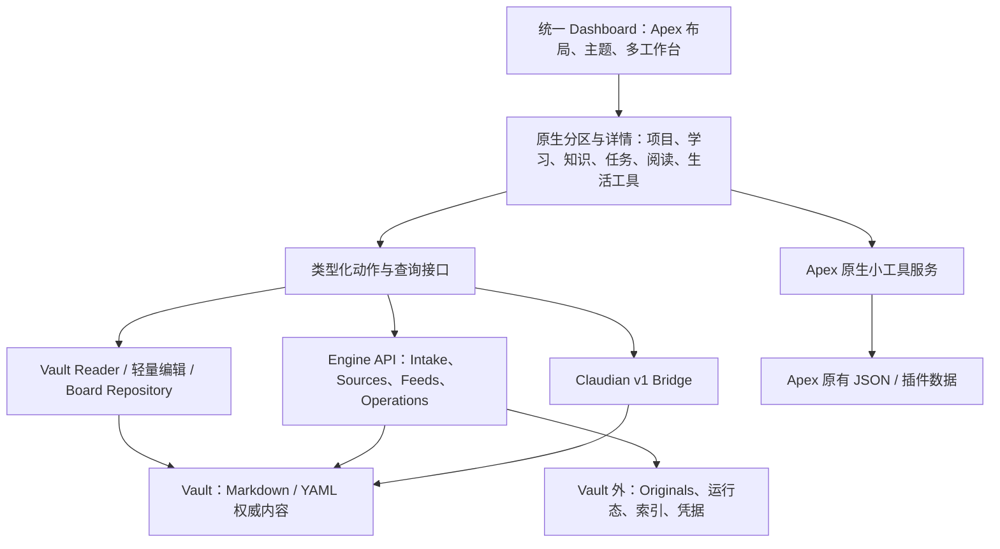

# Apex × OKF 统一工作台架构提案

日期：2026-09-21。修订：v2。状态：设计提案，未实施；不自动替换 `docs/architecture/` 的现行规范。

本次用户已明确：账目、打卡、人工阅读等 Apex 小工具继续采用 Apex 现有存储，不转换为 Vault Markdown/YAML。本文已据此取消长期记录契约与格式转换工作，也不把这种存储方式视为待偿还的临时方案。这里“保留原存储”包括原有数据格式、服务读写和既有同步/导出方式；插件 ID 变化时仅做必要的路径兼容。

配套实施文档：[完整开发流程与交付清单](APEX-DASHBOARD-DEVELOPMENT-PLAN-2026-09-21.md)。

分析基线：OKF 工作区 HEAD `f898c1d25cce2e41c4a74db00e963ad410517a5f`，Dashboard 1.15.0；Apex 2.5.4，提交 `dc7a7098689485f51a8b6195a691f8acc453b79a`。结论来自用户附件、当前契约与架构、双方源码以及独立临时 checkout 的验证，不是仅根据 README 推测。

## 1. 推荐决策

**在现有 `dashboard/` 中交付一个以 Apex 为界面基础的长期定制版：Apex 提供工作台交互与通用工具，OKF 定义正式领域对象与工作流；所有功能共用对象引用、操作入口、上下文和状态反馈。最终替代现有 Dashboard。**

这是一个产品、一个 Dashboard 插件、一个主界面。OKF 领域内容采用其契约语义；Apex 小工具采用原有数据模型。Engine、Dashboard、Claudian 继续保持当前三个构建单元和职责边界。统一产品不要求所有功能采用同一种存储，也不要求把 Python 服务和 AI Provider 装进同一个插件。

用户的五点要求对应以下架构目标：

| 用户意图 | 必须落实的设计 |
|---|---|
| 保留喜欢的 Apex 功能 | 保留布局、主题、多工作台、网页、日历、文件集合、数据库、媒体和生活工具；基线功能清单逐项验收 |
| 重叠功能选择更好的设计 | 正式 Project 使用 OKF 契约，展示吸收 Apex；任务、日历、记录入口真正共用读写规则 |
| 补充学习等独有功能 | 项目、学习、知识、订阅、待处理等进入同一个分区目录，也能展开深入操作 |
| 接受手动合并上游 | 保留准确上游来源与目录映射，集中维护必要补丁，实际演练升级 |
| 使用效果优先 | 以完整日常流程、信息一致、编辑可靠和功能无退化为交付标准；阶段交付不缩减最终范围 |

附件的总体方向正确，需要补足的是：分区接口之外的持久化接口、受管文件的通用编辑边界、任务日期与身份、多个 pane 的服务与写入协调、具体迁移和回退机制。

## 2. 两个项目实际提供了什么

### 2.1 Apex 是完整工作台，但还不是通用插件框架

已检查的主链路为 `main.ts → view.ts → renderer.ts`，工作台内容通过 `parser.ts / sync.ts` 保存。14 个添加分区选项、多个小组件、主题、网页与多工作台都已有实现；适合直接继承产品能力。双方都是 TypeScript、Obsidian API、直接 DOM 渲染和 esbuild，合并不需要迁移到 React 或另起一个 Web 应用。

但分区类型同时出现在添加菜单、解析器白名单、渲染分支、配置弹窗、同步操作和拖拽逻辑中。仅注册一个 renderer 不能获得完整原生分区能力。

源码依据：[添加分区](https://github.com/PandoraReads/apex-dashboard/blob/dc7a7098689485f51a8b6195a691f8acc453b79a/src/add-section-modal.ts)、[类型](https://github.com/PandoraReads/apex-dashboard/blob/dc7a7098689485f51a8b6195a691f8acc453b79a/src/types.ts)、[View](https://github.com/PandoraReads/apex-dashboard/blob/dc7a7098689485f51a8b6195a691f8acc453b79a/src/view.ts)、[渲染](https://github.com/PandoraReads/apex-dashboard/blob/dc7a7098689485f51a8b6195a691f8acc453b79a/src/renderer.ts)。

### 2.2 OKF 的主要资产是领域模型与完整动作

当前 Dashboard 已有直接 Vault 读取、契约化笔记创建、项目日志与决策、人工学习确认、Feed 判断、文档导入、后台操作监控、Digest 原生阅读增强及 Claudian v1 交接。已有分页、阅读位置、滚动和请求失效保护也是产品能力，不能在改成卡片时丢掉。

应复用 `VaultDashboardReader`、`VaultNoteService`、Feed/Import 客户端、Claudian adapter 和相关领域函数；从现有大型 `main.ts / dashboard-view.ts` 提取动作与控制器，再重做界面。不能直接实例化旧 Dashboard Plugin 作为新插件的内部依赖。

依据：[模块边界](architecture/module-boundaries.md)、[数据归属](architecture/data-ownership.md)、[直接读取](../dashboard/src/plugin/vault-dashboard.ts)、[笔记编辑](../dashboard/src/plugin/vault-note-service.ts)、[插件生命周期](../dashboard/src/plugin/main.ts)、[Claudian Bridge](../dashboard/src/plugin/claudian-bridge.ts)。

### 2.3 必须正视的差异与验证发现

| 已确认事实 | 对合并方案的影响 |
|---|---|
| Apex 添加菜单中 `projects` 标为有封面“笔记”，主要管理卡片和文件链接 | 保留为“笔记集合”；正式“项目”用独立类型，不能把旧卡片批量解释成 OKF Project |
| Apex `parse/serialize` 提取已知字段并重建 Markdown，未知分区退回已知类型 | 必须先支持未知内容保留、格式版本和稳定分区身份，再接入领域分区 |
| 当前 Apex 分区没有独立持久 ID，多处使用名字或数组位置定位 | 改名、同名分区、重排和多视图状态必须引入稳定 ID |
| Apex 每个 View 创建自己的 `SyncEngine`，其中有实例级写队列和整文件保存 | 同一工作台多 pane 编辑需要按工作台文件共享写入协调；一个实例的队列不等于所有实例安全 |
| Apex 数据库表格会直接改任意属性，属性看板会改分组属性，文件夹看板会移动实际文件 | 给这些入口增加契约感知的能力检查与动作路由，否则可破坏受管字段、引用和目录 |
| Apex 数据库新笔记按筛选预填属性；OKF 新文件还要求路径、公共字段和正文区域 | `type: Project` 筛选不等于合格 Project 工厂；必须派发到正式创建动作 |
| OKF 前端任务按特定根目录扫描，Engine 按排除规则遍历；前端行号相对剥离 YAML 后正文，Engine 相对原文件 | 现有两套投影本身就有差异，统一扫描规范和源文件定位是必做项 |
| Apex 扫描未跳过代码围栏和 YAML block scalar 中的复选框；提醒日期覆盖显式 due | 复用 UI 和日期解析能力，但修改扫描与日期规范，不能直接把扫描结果当正式行动任务 |
| Apex 日历新任务依次尝试目标日日记、今日日记、工作台任务清单，最后才创建目标日日记 | 统一版必须按上下文确定唯一落点，不沿用这个隐式 fallback 链 |
| Apex 习惯、账目、阅读、番茄记录有 JSON 持久化；微信读书进度路径硬编码 `plugins/apex-dashboard` | 不能只改 manifest ID；必须盘点和迁移数据路径、localStorage key、浏览器 session 分区 |
| OKF 当前是桌面插件，并顶层导入 Node 模块；Apex 支持移动端 | Apex 的移动支持不会自动使完整 OKF 可移动；需隔离桌面依赖后再声明移动能力 |

对应源码：[解析器](https://github.com/PandoraReads/apex-dashboard/blob/dc7a7098689485f51a8b6195a691f8acc453b79a/src/parser.ts)、[同步保存](https://github.com/PandoraReads/apex-dashboard/blob/dc7a7098689485f51a8b6195a691f8acc453b79a/src/sync.ts)、[数据库与看板](https://github.com/PandoraReads/apex-dashboard/blob/dc7a7098689485f51a8b6195a691f8acc453b79a/src/library-section.ts)、[任务扫描](https://github.com/PandoraReads/apex-dashboard/blob/dc7a7098689485f51a8b6195a691f8acc453b79a/src/alltasks-scan.ts)、[日历写入](https://github.com/PandoraReads/apex-dashboard/blob/dc7a7098689485f51a8b6195a691f8acc453b79a/src/daily-notes.ts)、[微信读书进度](https://github.com/PandoraReads/apex-dashboard/blob/dc7a7098689485f51a8b6195a691f8acc453b79a/src/weread-progress-store.ts)、[Engine 任务](../engine/src/okf_workspace/projections/tasks.py)。

## 3. 最终产品结构

### 3.1 工作台、分区、详情三层

- **工作台**保存布局、固定筛选和可选上下文，例如“日常”“阅读”“学习”“某个项目”。不同工作台展示同一批真实对象。
- **分区**是可组合视图，例如活跃项目、指定项目资料、某课程材料、今日任务、网页。具备同一套标题栏、筛选、展开、折叠、尺寸、拖拽、空态和错误反馈。
- **详情工作区**提供项目/课程/阅读的深入操作，可在当前 pane 展开或新 pane 打开，保留返回位置与筛选。卡片摘要与详情复用同一控制器和动作，不复制业务逻辑。

全局保留工作台切换、快速记录、搜索、导入、AI 入口和后台活动。系统故障只在可行动时突出；完整诊断留在系统设置。不要把所有复杂流程塞进小卡片或弹窗。

推荐预设：

| 工作台 | 默认内容 |
|---|---|
| 日常 | 快速记录、今日任务、待处理、近期项目、日历、中国热点/AI 资讯/树洞 |
| 学习 | 课程与学习归属、待生成/可学习材料、相关资料、网页、专注计时 |
| 项目 | 当前状态、下一步、行动任务、日志/决策、相关学习与资料、项目网页 |
| 阅读 | 订阅来源与历史、微信读书、书籍/阅读计时、用户已选择保留的资料 |
| 自定义 | 全部分区和小组件自由组合 |

预设仅是初始配置。项目/课程工作台可以绑定上下文；分区应显式选择“跟随工作台”或固定对象，不能暗中沿用用户上次查看的项目。

### 3.2 功能整合决策

| 功能 | 最终方案 |
|---|---|
| 布局、主题、Banner、多工作台、尺寸、拖拽 | 继承 Apex，统一扩展分区的操作与样式；初期保留其成对分栏逻辑，无需先重写通用网格 |
| 网页、图片、视频、相册、音乐、天气、倒计时、农历 | 保留；采用统一生命周期与设备能力检测 |
| 笔记集合、无封面笔记 | 保留 Apex 的文件组织能力；正式命名与 Project 区分 |
| 文件夹、数据库、DQL | 保留查询和多种展示；受管对象写入改用类型对应动作 |
| 正式项目 | OKF 对象与流程，吸收 Apex 卡片、封面、列表和看板交互 |
| 任务、日历 | 同一任务投影和写入路径；同一任务可以在多个视图出现 |
| 便利贴、备忘、快速记录、日记 | 保留不同记录用途，共用 Capture/Daily/Project 落点与转存动作 |
| 学习、知识、待处理、导入 | 完整原生分区与详情；保留所有现有工作流入口 |
| Feed、读书、阅读计时、微信读书 | 统一入口和上下文关联，各自保留正确数据含义 |
| 滴答清单 | 保留外部任务服务；通过 provider 展示和操作，不自动变成本地 Project/Task 的副本 |
| 习惯、记账、专注、人工阅读记录 | 沿用 Apex 界面、模型、服务与原有存储；必要时适配插件路径和生命周期 |
| Claudian 与后台任务 | 全局可达；采用既有 Bridge / Engine Operations，不由分区自己管理 |

## 4. 架构与代码组织



Actions 是一组具体接口和依赖注入，不是新增微服务、Broker、通用审批流或业务状态机。

### 4.1 推荐目录

```text
dashboard/
  apex/                       # Git subtree：完整上游来源树及明确的通用接入补丁
    src/
    scripts/
    styles.css
    LICENSE
    package.json
  src/
    plugin/                   # 唯一正式 Plugin 入口、设置和发布身份
    workbench/                # registry、宿主适配、详情导航、工作台存储
    application/              # Project/Task/Capture/Learning 等类型化动作
    features/                 # 项目、学习、阅读、知识、待处理等 UI/控制器
    adapters/                 # Vault、Engine、Claudian、Apex 宿主/路径适配
    shared/                   # 纯类型、主题 token 映射、局部状态工具
  tests/
  manifest.json               # 正式产物沿用 okf-workspace-dashboard 身份
engine/
  workspace/vault/system/     # 现行契约、需要新增的工作台/任务规范
tests/
  fixtures/                   # 合成任务语料、工作台迁移夹具、完整流程 Vault
docs/
  upstream/                  # 基线 SHA、接入点、补丁说明、升级验收清单
```

此处 `apex/` 是源码来源边界，不是第二个运行中的插件。最终由 `dashboard/` 构建一个插件包。现有 `feeds/`、`imports/` 等文件可逐步移动，不以目录重排作为第一阶段目标。

选 subtree 到 `dashboard/apex/`，而非把独立 Apex 仓库合并到 monorepo 根：上游路径关系稳定，OKF 新文件不混入上游源树，现有 Dashboard 服务可逐步抽取。与直接替换整个 `dashboard/` 相比，它也更容易保留当前发布/部署入口。

上游接入补丁只暴露通用接口，例如宿主初始化、分区注册、读写端口、数据路径提供者；不从 `apex/src` 直接 import OKF 业务文件。不以运行时 monkey patch 或继承巨大 Plugin 私有方法实现接入。可以提取上游初始化函数供正式 Plugin 调用，上游原入口使用默认实现，继续可独立构建验证。

保留上游验证所需独立依赖环境；统一产物在构建时解析到明确的依赖集合。无需为本次合并强制三个应用共享 lockfile，也不把上游仓库携带的 `main.js` 当正式产物。以类型检查和打包验证实际兼容性。

### 4.2 需要稳定的接入接口

| 接口 | 最小职责 | 不能承担的职责 |
|---|---|---|
| SectionRegistry | 元数据、默认配置、校验、迁移、挂载、更新、销毁、布局能力、支持的拖放 | Source 发布、学习完成判断 |
| SectionHost | 一致标题栏、尺寸、主题、错误隔离、展开详情、生命周期 | 保存所有分区业务正文 |
| BoardRepository | 解析/保留/局部修改工作台文件；按文件串行化本进程写入 | Project/Source 的权威存储 |
| VaultReader / 查询接口 | 同一对象的实时投影、关系解析、缓存失效 | 持久化第二份项目状态 |
| 具体 Actions | `setProjectStatus`、`createTask`、`setTaskChecked`、`captureThought` 等 | 重新实现 Engine 转换/发布流程 |
| ArtifactEditPolicy | 按 contract 提供字段编辑、创建、移动和关联能力 | 禁止用户在原生 Markdown 中自由书写 |
| CapabilityProvider | Vault 读写、Engine、AI、桌面 webview 等实际可用能力 | 仅按设备名称推断所有功能可用 |
| ApexNativeServices | 保留习惯/记账/阅读等原有服务，适配插件身份、设置和生命周期 | 强制把小工具数据转成 OKF Artifact |

分区示意（接口草案，尚未实现）：

```ts
interface SectionDefinition<C> {
  type: string;
  configVersion: number;
  createDefault(context: WorkbenchContext): C;
  validate(raw: unknown): ConfigResult<C>;
  migrate(raw: unknown, fromVersion: number): C;
  mount(host: SectionHost, config: C, services: WorkbenchServices): SectionInstance<C>;
}

interface SectionInstance<C> {
  update(config: C, context: WorkbenchContext): void;
  dispose(): void;
}
```

`WorkbenchServices` 传递可复用的读取和动作能力，不让每个分区启动 API、创建轮询器或自行读取 token。先实现真实需要的接口，不提前建设一个第三方插件市场。

### 4.3 生命周期与一致更新

- Plugin 级：Engine 管理器、Feed/Import 服务、操作监控、Claudian adapter、共享读模型、音乐/计时器服务和通知去重。
- 工作台文件级：共享 BoardRepository、修订信息和本进程写队列；所有 pane 对同一文件订阅同一源。
- View 级：当前工作台、焦点、详情导航、滚动、布局观测；同时打开不同工作台不互相切换。全局只保存“最近使用工作台”默认值。
- 分区实例级：筛选、渲染、订阅与可取消请求；销毁仅清理自身资源。

后台完成通知按 operation/conversion ID 去重。关闭项目分区或工作台 pane 后仍能完成和通知；停用插件/退出 Obsidian 时遵守现有托管 Engine 的停止和恢复机制，不承诺应用退出后继续运行。

文件变更只失效受影响对象与查询，避免一次 Feed 结果返回重建网页、重置阅读位置或重启计时器。晚到响应带请求版本并检查实例存活。同一个 Source 用于多个上下文时，状态查询使用 Source + use 上下文，不能只用 Source 路径推断全部用途是否完成。

## 5. 工作台存储必须先解决

### 5.1 布局引用与业务事实分开

工作台文件保存工作台 ID、分区 ID、排列、尺寸、主题覆盖、查询配置、对象引用以及原生便签/清单正文。正式项目状态、Source 用途、学习完成记录仍保存在对应领域文件。

推荐引入独立工作台格式版本，例如 `workbench_schema: 1`，与 `workspace_schema: 3` 和插件版本分离。新增工作台 Artifact 时先补正式 contract；建议位置 `workbench/boards/`，这是待实施路径，不是当前既有规范。

新增分区类型用 `workspace-projects`、`workspace-learning` 等稳定机器标识；界面只显示“项目”“学习”。旧 `projects` 继续表示笔记集合，避免上游更新和旧文件导入产生语义碰撞。

### 5.2 稳定身份与未知内容保留

- 分区 ID 持久化，与标题、位置无关。正文对应分区使用显式锚点/注释 ID 关联，避免两个“学习”分区按 H2 名称串配置。
- 领域对象继续以真实 Vault 引用为主，不为每个 Project/Source 新造第二套 UUID 注册库。工作台分区 ID、任务 block ID 是编辑定位工具，不是知识权威。
- 解析保存保留未知顶层字段、嵌套配置、未知分区、卡片扩展字段、注释及未识别正文。未知分区显示占位并允许保留/移动，不降级成项目后覆盖。
- 采用可保留 YAML 节点和 Markdown 原始区段的文档模型，或等价局部 patch。不能只在对象里加 `extras`，却仍在序列化时丢掉未识别正文。
- 未来版本高于当前支持范围时，保留原文并限制不可靠的写入；不能静默降级格式。

必须验证 `parse → 修改一个受支持字段 → save` 时其余未知区段仍在；不要求用户为了插件能读而删除自由文本。

### 5.3 编辑和并发

所有工作台编辑，包括布局、便签、工作台内任务、日历勾选和 DQL 勾选，都经过同一文件级写入路径。尤其不能让日历改了工作台里的任务后，另一个旧内存布局快照又把它写回未完成。

以当前磁盘内容为基础应用局部修改，并检查旧值/内容指纹。Obsidian 内部用 `vault.process` 和共享队列处理本进程竞争；遇到歧义重新读取并提示重试。**这不等于解决了 Engine、Obsidian Sync、外部编辑器之间的跨进程事务。** 跨进程写入仍需既有 Engine 原子更新、目标区域边界、冲突检测和真实并发测试；不要把 JS 队列描述成全系统锁。

引用卡片“移出工作台”只移除引用。工作台内直接承载正文的便签/清单，删除会删除其实际内容，应提供准确的删除/撤销体验；不能一律宣称移除卡片不影响内容。布局拖放、引用关联、正式状态改变也必须使用不同操作语义。

## 6. 项目：第一个完整融合的领域

保留当前结构和契约：`projects/<project>/project.md + log.md + decisions/`，`project_status` 仅 `active/paused/completed`。正文“下一步”与任务复选框是不同语义，不自动把一句下一步变成正式任务或反向覆盖项目状态。

项目摘要显示封面/图标、标题、状态、下一步、最近进展、任务摘要和相关资料入口；详情包含目标与范围、当前状态、任务、日志、决策、资料与学习。可以列表、封面卡片、按 `project_status` 的看板切换，所有动作共用服务。

关系规则：

- Project 的身份是 `project.md`；Course、Study Guide、Wiki 按现有显式关系投影。
- Source 通过 `uses[]` 的 `purpose + course + project` 表达使用，不改 Source 身份，不把同一资料复制到各项目。
- 同一 Study Guide 可在多个视图展示而不复制正文；没有明确关联的文件不能仅凭相似标题自动加入项目。
- 项目内快速想法生成带项目关联的 Capture；直接记录实际进展才写 log；正式决定走 Decision。
- 封面如果是项目共有属性，补充为可选字段规范并在所有项目视图共用；卡片在某工作台的大小和排位仅写工作台。

旧 Apex 集合只保留原状并重命名展示。用户选择“转为正式项目”时才调用 Project 创建动作，把原卡片关联文件作为引用导入，保留来源卡片和迁移映射；已有 OKF 项目通过明确选择关联，不以标题相同自动合并。

## 7. 任务与日历：统一语义，保留多个视图

### 7.1 任务来源与筛选

同一 Markdown 任务读取一次，可出现在今日、日历、项目、DQL 和工作台任务分区。清单正文不复制到“中心任务数据库”。

默认分两类：正式行动任务继续使用 `#task`；普通 Markdown 清单仍保留，并可在清单视图或日历显式开启。任务入口创建正式行动时自动加标记；不要求用户手工了解标签规则。受管项目文件中的历史清单不因升级被无提示改写。

建立一个由 Engine Workspace resources 发布的任务解析/选择规范，并提供 Python、TypeScript 共用的合成语料和期望结果。两种语言可分别实现读取器，不能各自解释语义；不为了共享代码让所有本地任务读取等待 API。

默认排除：模板、系统生成视图/导航、代码围栏、YAML 内容、转换正文、Feed/Digest 中转载的示例，以及明确的派生区域。不要排除所有 AI 区域：项目当前状态中的用户认可任务与来源正文中的示例性质不同，应按 artifact/region 规则确定。普通自由笔记允许配置纳入范围。

### 7.2 日期与任务身份

投影应分别承载：`scheduled`（计划做）、`due`（截止）、`start/end`（时间跨度）、`reminder`（提醒）、`completion`（真实完成），日期型值与带时区的时间点也应区分。提醒不能覆盖已有截止日期；没有日期的任务仍能在项目与任务视图出现。

兼容读取 Apex 的 inline fields 与 emoji 标记。新写入采用一套规范；既有只有提醒标记的任务可沿用其日历锚定显示，但不能无提示将所有旧提醒写成正式截止日期。多种冲突标记保留原文、展示可解释选择；编辑时只改用户指定字段。

建议新建正式任务使用 Obsidian block ID 作稳定锚点，旧任务继续可用“路径 + 原始整行 + 邻近上下文”定位，发生实质编辑时才按需要补锚点。外部 provider 使用 `provider + remoteId`；两个内容相同的任务不能按文本直接去重。

行号统一为原文件的一套基准，在 Obsidian API 适配层转换 0/1-based。前端目前剥掉 frontmatter 后的行号不能直接用于原文件写回。优先锚点，其次核验原行；同文多行无法唯一定位时不猜测修改。

### 7.3 明确写入落点

| 创建入口 | 权威写入位置 |
|---|---|
| 项目或绑定项目的工作台 | 该项目 `project.md` 的人工任务区域，日期只是任务属性 |
| 全局日历点击某日，无项目上下文 | 该日合格 Daily 的人工“任务”区域；存在即复用，不存在按契约创建 |
| 全局快速创建行动，无指定日期 | 今日 Daily 的任务区域 |
| 工作台内普通清单 | 当前清单原文；以后勾选仍定位该原文 |
| 滴答清单分区/外部任务 | 由对应 provider 写远端；失败显示失败，不回退创建本地副本 |

因此需要把现有 `createDaily()` 扩展为任意明确日期的创建能力，并与核心 Daily Notes 的路径设置对齐。升级时发现同日旧日记先列出映射，不偷偷生成另一份同日 Daily。

项目完成与任务全部完成不互相自动推导；用户可明确改变项目状态。复选框完成可记录任务完成时间，但绝不触发 `studied_at`。

日历可以进一步增加只读事件来源：Lesson、Decision、Daily、明确学习完成。它们不是待办；显示为历史记录，点击打开原文，不能统一显示成可勾选任务。阅读/专注记录保持 Apex 当前体验，不要求接入统一历史日历；以后若确有需要，可只读适配原服务，无需转换存储。外部日历/滴答任务使用来源标签和 provider 能力。

## 8. 记录、阅读、学习和知识的连接

### 8.1 记录

快速输入默认保存 Capture，并继承当前显式项目/课程上下文；用户可选择记入 Daily 或保留工作台便签。入口可以简单，落点必须确定。

便签转存：先成功创建目标并核验内容，再把原便签换成引用；失败保留原文。重复操作复用一次转存结果，避免双击产生多个 Capture。多文件操作不假装天然原子，需可恢复、可重试；不引入复杂发布 Saga。

Capture 后续处理遵守现行规则：成功转入长期目标后移除 Capture；明确丢弃进入本地回收站，不另造 Archive 副本。转存便签和处理 Capture 是两个不同步骤。

### 8.2 阅读与学习

保留 Feed 来源目录、搜索分页、各期历史、阅读位置、Digest 原生增强、判断状态和导入反馈。首页可紧凑，展开后应能完整浏览，不能只留下“最新几条”。

Feed 无动作继续留在 cache/Digest，不因“稍后看”或阅读计时自动创建 Source。用户选择 study/wiki/reference 后才通过 Engine 应用工作流创建或复用 Source；Intake 的明确待判断用途则沿用 `undecided`。用途与“现在/稍后生成”分开。

微信读书/书籍计时先建立外部书籍身份和可选 Vault 关联，不假定可以获得全部正文。正式资料导入只处理实际可访问的内容/导出/笔记，通过 Intake/Sources 保留来源；不把书名、阅读完成标志当成已有 Source Text。

学习分区保留 Course、Project-related、Independent 及三者并集。Course/Lesson、Study Guide、Wiki 的动作和状态分别展示：

- 生成材料不等于学完；阅读页码、计时、完成读书、测试分数都不自动写 `studied_at`。
- 用户明确确认学习完成时才写入；撤销确认移除相应记录。
- 未学习但用户认为有长期价值的资料仍可直接生成 Wiki。
- 知识分区保留未复核生成标记、失效提示、Wiki Map 及原文跳转；不强迫材料先学完才能沉淀。

全局 AI 操作带真实 contextPaths、明确动作和 Vault Skill，沿用 Bridge v1。网页内嵌浏览器不自动获得 Vault/Engine 权限；AI 处理的是用户显式交接的可用内容。

## 9. 通用编辑与数据归属

### 9.1 契约感知的编辑不是全局只读

这是附件最需要补充的设计。Apex 通用数据库能力应保留，但知道自己正在编辑什么。

| 对象/操作 | 路由 |
|---|---|
| 普通笔记的常规属性、标签 | 本地轻量编辑，保留未知字段 |
| Project 看板改变状态 | 校验枚举，调用现有 `setProjectStatus` 的统一动作 |
| Study Guide/Wiki 学习完成 | 明确用户动作调用 `setStudyCompleted`，不使用任意日期输入自动推断 |
| Source `resource/kind/text/uses`、Source Pair 路径 | Sources/应用工作流处理；不能被普通分组拖放或表格字符串转换覆盖 |
| 文件夹看板移动受管 Project/Source/课程文件 | 提供受支持的领域操作；没有合法迁移能力时保留展示与原文入口 |
| 在 `type: Project/Course/...` 筛选下“新建” | 对应 Artifact 工厂，生成正确路径/字段/区域；只把兼容的筛选作为可选预填 |
| DQL TASK、日历勾选 | 同一 Task 写入接口，不能绕过工作台写入协调 |

这层规则来自部署的 contract 和少量具体动作，不复制一套 Frontmatter 规范。用户仍可直接编辑 Markdown；重新读取后发现不合约内容应给出具体诊断，不自动覆盖或隐式修复用户原文。

### 9.2 长期事实、显示偏好、运行态分别存放

| 数据 | 目标权威/存储 |
|---|---|
| Project、Course、Lesson、Study Guide、Wiki、Source、Capture、Daily | 现行契约化 Vault Markdown/YAML |
| 工作台布局、分区配置、对象引用、内嵌便签/清单 | 版本化工作台 Markdown，新增 Profile contract |
| 滚动、窗口布局、设备主题偏好 | 插件/设备设置；不是领域事实 |
| 习惯记录、账目、人工阅读记录、已完成专注记录 | Apex 原有 JSON / 插件数据，由对应原生服务读写；不新增 OKF 记录契约 |
| 微信读书远端进度镜像、天气、封面、可重建统计 | 派生缓存，可继续 JSON；丢失可重建 |
| 活动计时器、播放位置、请求队列 | 运行态；JSON 等合适格式即可 |
| Feed cache、Operations、Originals、检索索引、凭据 | 继续在 Vault 外由既有服务管理 |

**按用户当前明确决定，Apex 小工具原存储就是本次融合后的正常方案，不安排后续自动 Vault 化。** 账目和阅读历史继续是应保留的用户数据，不能当作缓存清理。它们可以物理存放在 Vault 的 `.obsidian` 插件目录，但不转成领域笔记，也不进入 OKF 的 Artifact 契约、Source 流程或任务扫描。

本次只要求：服务使用新插件提供的正确目录；已经存在的 Apex 数据可以按原格式接管；没有旧数据时正常初始化；原有导出和同步能力不因合并失效。不新增记账/打卡/阅读记录状态机、通用账本格式或一套同步系统。

若插件 ID 改变，选择在新插件目录使用相同文件格式，并对实际存在的旧文件执行一次可重复检查的导入。新旧目录都有数据时不盲目覆盖或发明合并规则，应沿用已有明确合并能力或保留两份供迁移选择；确认接管后只使用一个写入位置。不存在旧 Apex 安装时，这一数据接管步骤为空操作。

实施阶段在 `docs/architecture/data-ownership.md` 明确此边界：OKF 领域内容由 Vault Markdown/YAML 承担语义权威；Apex 原生小工具数据由各自服务与现有存储管理。这是落实本次用户决定，无需另行征求是否将小工具 Vault 化。

## 10. 上游维护与发行

1. 导入时锁定上述 SHA，记录版本、仓库 URL、subtree 路径和本地补丁列表。推荐保留完整 subtree 来源历史；不要将 `--squash` 描述成保留了全部原始历史。
2. 上游更新先进入候选分支，对照上次 SHA 分析功能变化；通用主题、网页、媒体等尽量按模块吸收，旧项目命名和任务写入变化必须审查语义。
3. 接入补丁集中覆盖：宿主启动、registry、工作台 codec/存储、读写路由、设备能力、路径提供者。维护修改理由和对应回归场景，不追求补丁行数极小。
4. 上游核心确实不符合目标时允许实质重构；避免对未涉及的文件进行全面格式化/重命名，减少无意义冲突。
5. 根 `dashboard/manifest.json` 沿用 `okf-workspace-dashboard`，保留当前命令和部署身份；上游 `apex-dashboard` ID 不作为最终发行 ID。当前 Apex 最低 Obsidian 为 1.8.7，新包不能无验证继续声明旧 Dashboard 的 1.6.0。
6. 扫描硬编码 ID、存储路径、CSS root、localStorage 和 Electron session 分区。保留 CSS 类名便于合并不等于必须共享真实数据目录；session 迁移需单独验证，不能保证改名后自动保留登录态。
7. 上游 LICENSE 文件是 MIT，package.json 却标 `0-BSD`，这是本次发现的元数据不一致；保留原始 LICENSE/版权信息并在导入记录中注明，发行元数据统一前核对来源。
8. 更新 Engine/Dashboard 兼容版本、release manifest、部署和插件迁移脚本；Claudian Bridge 没有协议变动就不升级协议或重构 Provider。

验收至少做一次真实“旧锁定基线 → 新上游提交”的升级演练，并记录冲突、耗时和回归结果。源码合并干净不能替代语义验收。

## 11. 迁移与切换

迁移先产生可读清单：输入版本、将创建/修改的路径、旧卡片映射、设置映射、记录数量和不能自动处理的情况。正式操作采用版本化、幂等、可恢复的转换。新旧插件只在隔离的合成/复制 Vault 中对照，不让两个实现同时接管同一份生产工作台。

迁移范围包括：

- 现有 OKF 设置、Engine 地址/启动配置、token 文件引用、Claudian ID、UI 状态、Feed 阅读位置。
- Apex 工作台文件、布局、内嵌正文、卡片与分区身份、文件引用、小组件设置；实际存在的生活工具数据仅做原格式路径接管。
- 路径差异：Apex registry 不带前导 `/` 和 `.md`，OKF 关系常用 `/...md`；在适配边界规范化，不能全局小写化以免跨平台路径错误。
- 外部网页、音乐和滴答的登录状态/设备能力；不能把 cookie 当普通配置文本复制。
- 与原有 Daily Notes/快捷命令的映射，避免两个“新建日记”落点。

引用迁移不移动 Project/Source 正文。重命名关联文件时使用 Obsidian 路径解析并验证 YAML 普通路径字符串也得到正确处理；不能仅依赖“自动更新内部链接”。删除文件后显示可定位的缺失引用，不自动创建一个空项目替代。

回退以切换前原始文件和插件包为边界。新格式工作台不要交给原版 Apex 保存；已在新版本产生的领域数据不能在回退时被整库快照覆盖，应按变更清单保留并选择性回迁。没有价值的开发夹具不构成兼容性负担，但真实用户数据必须保留。

## 12. 实施顺序与完成门槛

| 阶段 | 工作与依赖 | 可验收结果 |
|---|---|---|
| A 基线与功能清单 | subtree 来源、独立构建、单一发行身份、Apex 功能清单、OKF 动作清单 | 在合成 Vault 运行 Apex 基线，原功能可用，来源与检查可复现 |
| B 安全的宿主和存储 | registry、未知内容保留、分区 ID、文件级写协调、受管编辑策略、Plugin 级服务 | 两个 pane 修改同一工作台不覆盖；未知分区保存后还在；通用编辑不会绕过领域规则 |
| C 第一条完整融合链 | Project 摘要/详情、正式 Task 规范、日历写路由、Daily、Capture 上下文 | 项目建任务 → 日历展示/完成 → 项目同步；同时保留网页/日历/原文件集合 |
| D 完整 OKF 工作流 | Learning、Knowledge、Inbox、Feed/Reading、导入、Digest 原生动作、AI 交接 | 原有每个动作都可达，来源/用途不丢、后台状态独立于分区 |
| E 使用体验与兼容 | Apex 原存储路径兼容、布局预设、键盘/触摸、低干扰刷新、性能与恢复 | 小工具原样可用；网页不因无关更新重载；阅读位置恢复 |
| F 正式切换与上游演练 | 幂等迁移、部署/版本更新、旧实现移除、回退验证、一次实际上游更新 | 新 Dashboard 独立运行，根检查与完整场景通过，旧 Dashboard 不作为依赖 |

阶段 C 适合做第一个可以日常评估的版本，但它不是最终整合完成。Phase B 也不应变成无限期“先写平台”：围绕项目/任务/日历这条路径实现必需能力，随后扩展。

桌面完整替代是当前环境的首要发行门槛。保留 Apex 移动交互实现；要发布移动支持，必须拆分 Node-only 模块、做能力适配并实测后才更改 `isDesktopOnly`。远程 Engine 是独立部署方案，不能仅把现有 loopback URL 换成公网地址。

## 13. 验收矩阵

| 场景 | 成功标准 |
|---|---|
| 项目创建带日期行动 | 项目、今日、日历显示同一任务；任一入口完成后其余更新，无复制正文 |
| 同一项目放两个工作台 | 修改状态同步；移除一个引用不删除项目；两个分区可独立筛选 |
| 同名分区改名/重排 | ID、配置、折叠、滚动和正文仍对应正确实例 |
| 日历勾选工作台清单后调整布局 | 完成状态不会被布局保存覆盖 |
| 代码块/YAML/Source Text/Digest 中的复选框 | 不混入正式行动；普通清单按明确筛选可访问 |
| 提醒早于截止，计划日不同于截止日 | 分别显示、修改；提醒不会更改截止日 |
| 重复任务文本、文件重命名、行号变化 | 找到原任务或明确要求重读，不误改另一行 |
| 数据库对 Project/Source 做属性编辑或拖放 | 使用合法动作；不能破坏 identity、pair、区域或路径 contract |
| 缺少某日 Daily 时从日历建任务 | 创建该日合约文件，不悄悄写到今天或别的工作台 |
| Feed → study/wiki/reference，多项目复用来源 | 同一 Source，独立 uses，上下文正确，幂等，无隐式兴趣判断 |
| 读完书/计时结束/Study Guide 生成 | 不写 studied_at；只有人工确认能写 |
| 便签转 Capture 中断/重复点击 | 原文可恢复，没有独立正文双副本长期并存 |
| 关闭分区/最后一个工作台 pane | 后台任务继续、只通知一次；重新打开能看到真实结果 |
| Engine 不可用 | Vault 阅读/轻量编辑继续；导入/生成显示具体不可用状态 |
| Claudian 未启用 | 可继续使用其余工作台；AI 入口明确提示并提供原文/上下文退路 |
| Feed 返回/笔记更新/主题切换 | 无关网页、音乐、计时器不重置；阅读分页与位置保留 |
| 未知字段/分区/自由正文/更高格式版本 | 可保留、可识别兼容限制，不能保存后静默消失 |
| 老 Apex 数据接管两次、迁移中断后重启 | 原格式不变、不覆盖人工修改、不创建对应 Vault 笔记；记录保留且仅一个位置继续写入 |
| 上游更新 | 原功能和融合场景均通过；不是只检查 Git 冲突和 TypeScript |

测试层次：上游现有验证脚本；Dashboard Vitest/类型检查/生产构建；Python 改动的 pytest/Ruff/Pyright；共享任务语料与合成 Vault 集成测试；根 `scripts/check.ps1` 与 `scripts/build.ps1`；真实 Obsidian 中的多 pane、webview、停用重启和必要的移动端人工验证。

性能在合成 1k/10k 笔记、多个任务/学习分区和若干网页的场景下测冷启动、热更新、读文件次数与内存；冻结可用基线后再确定回归阈值。核心要求是增量读取、合并相同请求、隐藏分区按需加载、无全工作台重建，不凭空承诺固定毫秒指标。

## 14. 验证记录与边界

上一轮源码分析已在独立临时 checkout 安装 Apex 锁定依赖并完成以下验证；本次 v2 是架构与开发文档修订，未重复执行产品测试：

- `npm run build`：通过，包含 TypeScript 检查与生产打包。
- `test:calendar-task-insert`、`test:calendar-section`、`test:web-section`、`test:card-move`、`test:kanban-upgrade`、`test:weread-progress`、`test:mobile-stability`：全部通过。网页测试中的 offline/timeout 日志是脚本主动覆盖的异常场景。
- 直接调用上游 `parse/serialize` 的合成探针：未知 `okf-learning` 变为 `projects`；未知顶层/分区字段和 H2 后非卡片自由段落均未保留。
- 直接调用 `scanFileTasks`：YAML 多行字符串和代码围栏中的复选框均被读取；显式 `due: 2026-09-25` 与 `⏰ 2026-09-23` 共存时返回 due 为 `2026-09-23`。

这些探针验证了整合前置工作的必要性；上游测试通过与存在整合边界并不矛盾。没有对真实 Obsidian 登录、生产 Vault、远端滴答/微信读书账户或移动设备做验收。本次修订设计提案并新增配套开发计划，未导入 Apex 到正式代码、未修改实现/部署/现行契约，也未执行迁移。仓库已有的可靠性文档修改保持原样。

**最终选型标准：保留 Apex 已成熟的使用能力，让 OKF 的领域规则贯穿所有相关入口，并为真实编辑和长期维护建立明确边界。用第一个项目—任务—日历闭环证明架构，再完成全部功能替代。**
