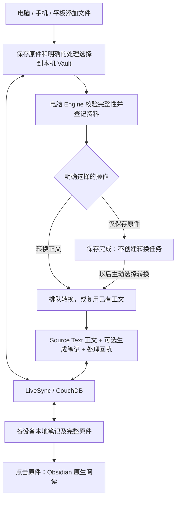

# 原件随 Vault 全量同步

2026-10-06 起，用户明确选择用存储空间换取简单、可靠的阅读与同步。活动架构只有一条跨设备传输链：LiveSync。独立原件服务、按需下载和设备阅读缓存已经退出正常流程。

## 保存位置与职责

- `sources/originals/<sha256>/<原文件名>`：完整原件。内容哈希目录区分同名不同内容，正常重复导入复用已校验的文件。
- `sources/records/`：资料信息、原件路径与用户用途；没有第二份 PDF，正文链接可缺省。
- `sources/text/`：转换后的 Markdown，供搜索和学习，不是原件副本。
- `sources/assets/`：最终转换正文实际引用的图片，随正文同步；不复制未被正文使用的 OCR 裁剪图等解析器附件。
- `system/imports/<uuid>/`：各设备提交的处理选择与电脑处理回执。
- Vault 外的 State：转换执行状态、索引、临时工作文件、密钥。不参与跨设备笔记同步。

`deployment.json` 中旧 `originals` 字段只保留安装兼容性和迁移来源意义；新导入不再写入该目录。旧目录及服务器旧文件暂留作回退备份。

导入生成的 Source Text 用 `sources` 指向资料的 Source 记录，图片保留在正文对应位置，
不再在 YAML `assets` 中逐张枚举。完整转换结果、附件清单与质检报告保存在 Vault 外的
State `conversions/<id>/export/`，供重试和排错。发布和成功状态写入完成后清理同任务的
`working/` 临时目录；失败、中断的任务保留临时文件。完整 `export/` 暂不自动过期，
不会同步到 CouchDB。已有测试资料和旧附件不自动迁移或删除。

## 导入与阅读

电脑、手机和平板的工作台统一通过 Obsidian Vault API 保存原件，校验成功后写申请。断网时也能完成本机保存；联网且 LiveSync 运行后同步。电脑接收顺序不作假设：申请先到时等待原件完整。长度和 SHA-256 相符后，`store` 只登记资料，`convert` 才提交转换。重复扫描不重复排队。

按钮、拖放默认仅保存。API 和 CLI 继续由 Engine 接收；显式 `action=store`（CLI 为 `--action store --intent source`）绕过解析器，旧调用缺省仍转换。原件一旦保存即可同步和阅读；转换失败不影响已有原件。新文件不再进入 `inbox/uploads`。

电脑未运行时，资料列表从导入记录展示本机已保存的原件；正式 Source 由电脑接收后登记。记录到达其他设备而原件尚未到达时提示等待同步。同一哈希和归属的重复记录合并展示；课程或项目关联不触发转换或 AI 生成。已有正文可直接生成笔记，失败的生成请求只有用户再次提交时才重试，不重新解析原件。

PDF 和图片由 `WorkspaceLeaf.openFile(TFile)` 在 Obsidian 中打开，无需本地 API、HTTP 下载、Blob 弹窗或 WPS 交接。Office 格式仍受 Obsidian 支持范围限制，可阅读转换正文，或由用户自行用外部应用打开附件。文件尚未到达时明确提示等待同步。

普通 Vault 附件右键“导入为资料”不自动删除原位置的文件或修改已有嵌入链接。已经在正式原件目录中的文件会复用。不要直接覆盖已归档版本；批注或改版应另存再导入，校验不符时程序会保留修改并报告。

当前导入入口的单文件上限仍为 64 MiB。各设备 LiveSync 上限至少为 64 MiB，且不得排除 `sources/originals/`。全量同步会占用每台设备及 CouchDB 的空间，服务器实际占用包含分块和修订开销。

## 旧版迁移

1. 备份当前 Vault、State 和旧 Originals，停止 Engine 的写入任务。
2. 执行 `python -m okf_workspace.importers.vault_original_migration --vault <Vault> --originals <旧 Originals> --state <State>`。
3. 先完成所有原件的复制与哈希校验，再更新旧 `okf-original://` 引用和转换状态中的原件路径。保留未知 YAML、用户正文、转换身份和旧原件。
4. 更新 Engine、工作台程序和部署的 Vault 规则，再启动并完成 LiveSync。
5. 平板加载新版后，一次性恢复旧 IndexedDB 中未完成的上传到 Vault；只在校验本机副本与保存申请成功后释放旧上传字节。已有申请不覆盖、不重复提交；异常保留数据并提供重试。
6. 已迁移的旧协议链接仍可打开 Vault 原件。旧 `file-store` 申请只能使用迁入 Vault 的原件，不再访问旧服务。
7. 校验各旧服务 blob 都已迁入 Vault 并做好备份后，停止原件服务及其独立定时备份，移除 `/original-files` 路由。保留 CouchDB 的根路由、同步服务和现有备份。

同步不是备份。CouchDB 和包含原件的 Vault 都应保留独立备份。旧服务源码和部署资产只用于历史恢复；新安装无需部署它。

## 验证

- `dashboard/tests/synced-intake.test.ts`：字节先于申请、重复导入、改动保护及旧设备上传恢复。
- `dashboard/tests/vault-original-open.test.ts`：Source 来源链与原生 Obsidian 打开，无外部读取依赖。
- `engine/tests/integration/test_vault_original_migration.py`：迁移可重复执行，保留旧数据、正文和身份。
- `tests/e2e/test_synced_mobile_import.py`：实际 TypeScript 保存 → Python 接收转换 → 回传。
- `tests/e2e/test_remote_original_import.py`：实际旧版离线上传 → 新版本机恢复 → 全量同步导入，全程不启动文件服务。
