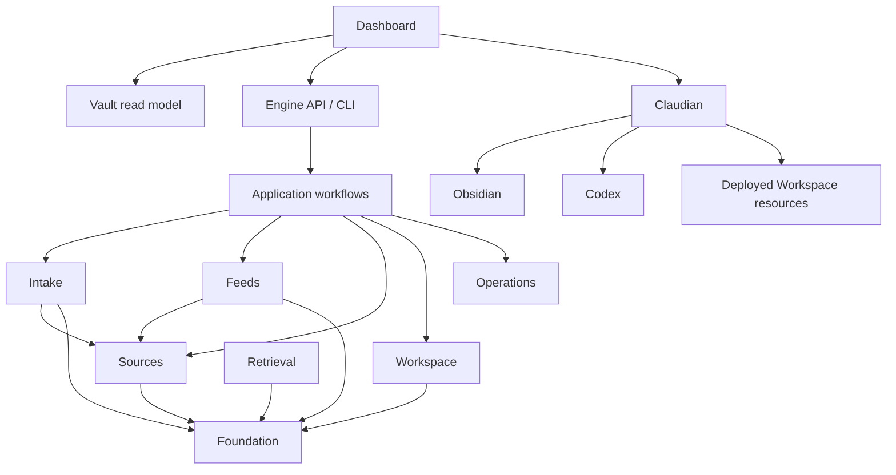

# 架构与数据模型

[文档入口](../../README.md#文档入口) · [接口](../INTERFACES.md) · [Contracts](../../engine/workspace/vault/system/contracts/README.md)

本文件维护模块职责、数据归属与跨类型语义；字段、枚举、路径及正文区域的精确格式由
`engine/workspace/vault/system/contracts/` 定义。模板、Skills 和所有写入器共用这些 Contracts。

[交互式信息流与架构图](visualizations/index.html)可离线查看信息分支、模块与部署关系，
[静态总览](visualizations/overview.svg)用于预览。图形来源与生成方法见[开发指南](../DEVELOPMENT.md#架构可视化)。

## 系统概览

OKF Workspace 由三个独立构建的应用组成：

| 应用 | 职责 |
| --- | --- |
| Engine | 领域模型、确定性工作流、Intake、Feeds、检索、API、CLI、后台任务与可部署 Vault 规则 |
| Dashboard | Obsidian 工作台、Vault 读取与简单人工等价编辑，通过 Engine API 请求领域操作 |
| Claudian | 助手界面、会话、Provider runtime，通过公开 Bridge 接收任务与上下文 |

Vault 中的 Markdown/YAML 与原件保存长期内容。Runtime State、索引、缓存、会话与秘密位于源码仓库外。
原件位于 `sources/originals/<sha256>/<filename>`，与笔记、申请和回执通过 LiveSync 全量同步；
各设备使用 Obsidian 原生查看本地文件。旧 Originals 服务及外部存储只保留历史恢复用途。

Intake 和 Feeds 属于 Engine。文档转换默认使用 MinerU 云端，也支持明确选择 MarkItDown 或启用的自建 MinerU；
Engine 负责方式固定、格式校验、QC 和发布，失败保留所选方式。配置与迁移见[部署指南](../DEPLOYMENT.md)。

## 模块边界

- Foundation 只包含 Contracts、frontmatter、路径、关系、原子文件操作和基础类型。
- Sources 独占 Source／Source Text 身份、查找与成对发布；Intake 和 Feeds 不互相调用实现。
- 跨模块操作由应用工作流组合；Dashboard 不复制转换、发布或后台语义状态机。
- Dashboard 请求 Engine 写入时携带当前 Vault fingerprint，Engine 拒绝身份不一致的写入。
- Obsidian 打开 Digest 时，Engine 提供路径和 Markdown；Dashboard 仅创建缺失文件，已有笔记由 Engine 刷新。
- Claudian 的业务规则来自部署到 Vault 的 AGENTS、Contracts 和 Skills，Provider 内不复制这些规则。
- Apex 小组件由统一宿主管理生命周期，保留原生数据格式；插件身份接管须可重复执行，保留人工修改和唯一写入者。

### 本地优先的文件导入

Dashboard 通过 Vault API 先保存完整原件，再写入 `system/imports/<uuid>/request.md`。
桌面与移动端使用同一申请格式，LiveSync 到达顺序不限。指定桌面 Engine 对私有快照核验长度和 SHA-256：
`store` 只登记 Source；`convert` 进入转换队列，后续生成复用已发布正文。凭据、执行状态与索引留在 State。
移动端只保存文件和申请，读取原件通过 `WorkspaceLeaf.openFile`，无需 HTTP 原件服务。
旧设备上传恢复和 `okf-original://` 兼容处理见[迁移流程](../DEPLOYMENT.md#original-migration)。

## 数据归属

| 数据 | 所有者与存储 |
| --- | --- |
| Capture、文件导入申请／回执 | Intake；Vault 保存内容和显示投影，执行权威在 State |
| 原件与正文引用附件 | 用户持久内容；Intake 核验，LiveSync 复制完整字节 |
| Source 身份、用途和 Source Text | Sources |
| Feed cache、Digest 与决定回执 | Feeds |
| Course、Lesson、Study Guide | Workspace Learning |
| Wiki、Wiki Map | Workspace Knowledge |
| Project、log、Decision | Workspace Projects |
| Daily、Reflection、Review | Workspace Life |
| 语义与转换运行状态 | Operations／Vault 外 State |
| Contracts、模板、Views、Policies、Skills | Engine 的可部署 Workspace 资源 |
| Apex 习惯、记账、阅读、专注与小组件状态 | Apex 原生服务及 JSON／plugin data |
| 工作台布局、便签、清单及安全副本 | Dashboard/Apex 工作台 Markdown |

### Artifact 与公共字段

外部 OKF 兼容读取要求 YAML 可解析且 `type` 非空，容许未知类型、扩展字段与断链。
Workspace 自产文件严格遵循 Profile v3 Contracts；每次更新保留未知字段与用户正文。

公共必填字段只有 `type`、`title`、`created_at`。路径负责稳定定位，`title` 用于结构化展示，H1 用于原生阅读；
mtime 表达最近修改时间。`status` 只表示 `draft` 或 `deprecated`，缺失即稳定；兼容读取 `stable`，新写入省略。
`tags` 用于浏览和搜索，空 `aliases`／`sources` 通常省略。`resource` 为 Source 必填，`description` 为 Wiki／Wiki Map 必填。
不生成 `owner`、`updated_at` 或独立的学习／生成／路由状态字段；排队、进度、失败与重试归 State。
只有确实随时间失效的内容设置 `stale_after`，当天日期达到该值时提示陈旧，不自动改写。

| 类型 | 默认位置与关键语义 |
| --- | --- |
| Capture | `inbox/captures/YYYY/MM/`；文件存在表示待处理，新写入包含 `ingested_via`，网页记录另含 `resource` |
| Daily、Reflection、Review | `life/daily/`、`life/reflections/`、`life/reviews/`；日期和周期结构遵循各自 Contract |
| Project、Decision | `projects/<project>/project.md` 与 `decisions/`；Project 状态为 active／paused／completed，Decision 含 `decided_at` |
| Course、Lesson | `learning/courses/<course>/course.md` 与 `lessons/`；Course 状态为 active／paused／completed，Lesson 含 `lesson_at` |
| Study Guide | `learning/guides/` 或课程 `guides/`；可关联课程、项目、来源与明确的学习完成时间 |
| Wiki、Wiki Map | `knowledge/wiki/`、`knowledge/maps/`；Wiki Map 按导航需求或用户要求维护 |
| Digest | `feeds/<feed>/YYYY/`；原生可读的 Feed 期次，包含 feed、digest_id、issued_at、items |
| Source、Source Text | `sources/records/<kind>/` 与 `sources/text/<kind>/`；分别保存资料身份与实际正文 |
| Profile、Agent Policy、System View | `self/`、`system/policies/`、`system/views/`；用户上下文、AI 边界与原生导航 |

Capture 成功整理到一个长期目标后删除，明确丢弃进入本地回收站，不额外建立归档副本。
Web Capture 先发布为 Source／Source Text。Project `log.md` 是不含 YAML 的连续时间日志。
根 `index.md` 只作人工导航。普通编辑局部校验；部署、迁移和专项审计执行完整 Profile 校验。

### 人工内容与 AI 写入

人工监督下的讨论、格式整理和明确发起的可见生成按正常用户内容保存。
只有无人值守后台生成、长期复用且尚未检查的 Wiki 写 `generated.by: process:codex-background` 与生成时间，保留来源。
`verified` 记录实际核验人或流程及时间；打开笔记不算核验。
`studied_at` 只在用户明确确认学完时写入，生成、阅读、讨论和答题均不自动设置它。

后台仅原子替换目标允许的 AI 区域，保留 `human:notes` 和其他人工内容。
Daily 使用 `linked-activity`／`organized-daily`，Lesson 使用 `organized-lesson`，Study Guide 使用 `study-material`，
Project 使用 `project-current-state`，Wiki 使用 `wiki-content`。区域标记和完整字段见各自 Contract。
交互式修改仍须有用户对目标范围的明确授权。

### Source 与用途

Source 必填 `resource`、`kind`、`uses`。前两者定义与上下文无关的资料身份；`ingested_via` 记录首次进入渠道，
取值为 `web-clip`、`file-import`、`feed`、`direct-entry`。未知的历史渠道保持缺失，界面显示“未标注”。
只有正文存在时才写 `text`，指向同 basename 的 Source Text；保存原件可以独立成立。
新写入包含 `ingested_via`，跨 Web Clipper／Feed URL 去重复用身份并保留首次渠道。

人工决定保存在 `uses[]`，按 `purpose + course + project` 幂等合并。
课程和项目均为可选的真实 Vault 路径，缺失时省略；同一 Source 可服务多个上下文。

| `purpose` | 后续行为 |
| --- | --- |
| `study` | 按明确请求生成 Learning 的 Study Guide |
| `wiki` | 按明确请求生成 Knowledge 的 Wiki |
| `reference` | 保留资料，不自动转换或生成成果 |
| `undecided` | Intake 中明确要求暂存，进入收集箱等待判断 |

正式的 study／wiki／reference 决定仅清理这次上下文覆盖的 undecided：无上下文待决定项，
或其课程／项目与新决定相符的待决定项。其他待决定项和已确认用途保持不变。
Feed 暂不操作时继续留在 cache 和 Digest，不创建 Source、决定回执或 undecided。
“现在生成”额外创建后台 Operation，“稍后生成”只保存用途；不存在空白目标占位笔记。

导入只发布最终正文引用的附件到 `sources/assets/`，附件依赖由正文链接表达；
`Source Text.sources` 只指向 Source，不重复列图片清单或新增 YAML `assets`。
完整转换 export、manifest 与 QC 留在 State。发布和成功回执持久化后才清理 `working/`；
失败或中断保留临时文件，可从 export 恢复，不自动清理已有 Vault 附件。

### 项目类别

`project_category` 是可选单值主类别：首尾去空白后 1–80 个 Unicode 字符，不含控制字符，区分大小写，
无固定枚举；缺失即未分类，清除时删除字段，多主题使用 tags。类别仅保存在项目主页，关联内容通过项目关系查询。
修改保持路径、状态、正文、任务和未知字段；AI 不自行推断类别，旧项目无需补写。
批量改名逐项检查原类别，合并时展示影响与成功／失败结果。
看板分组、置顶和手动顺序属于视图状态；跨类别列修改 `project_category`，跨状态列修改 `project_status`。

### 任务与工作台

普通笔记任务由内嵌 Tasks 管理。Tasks 配置单向导出 `system/views/Tasks.md` 的 `task_statuses` 与
`task_projection` 供 Engine 读取；存在全局查询时 Engine 明确报告无法解释该查询，完整查询由 Dashboard/Tasks 执行。
工作台清单由所属工作台独立管理，两种任务投影均排除工作台、安全副本及来源示例等不适用内容。
格式、状态、日期、循环、依赖与笔记交互沿用 Tasks；具体操作见[使用指南](../USER-GUIDE.md#tasks)。

工作台通过顶层 YAML 布尔值 `dashboard: true` 识别，与路径和注册表无关。
缺失 `workbench_schema` 兼容旧工作台，正整数属于身份兼容版本；Dashboard 负责布局兼容与未知内容保留。
空 type 可容忍，非空 Artifact type 与工作台标记并存属于身份冲突；非布尔标记、无效 schema 和异常 YAML 报错并保留原文件。
Engine 不向工作台强加 Artifact 字段或标题，Artifact 发布器拒绝工作台目标；迁移逐字节保留工作台及异常身份文件。

新工作台文件名保留 Unicode。改展示名不重命名文件，取消注册不删除 Markdown。
注册表缺失时，从有效 frontmatter 恢复，排除隐藏目录、安全副本和根 index；按路径排序，优先 dashboard，否则首项。
显式注册路径即使尚未同步也保留；存储读取失败停止恢复。
默认全文／向量检索排除工作台及根 `.dashboard-backup/`，索引同步清除旧条目；明确附加给 AI 时读取当前正文。
工作台仍参与备份和恢复，便签转 Capture 由用户明确执行。Vault Git checkpoint 仅在用户主动启用后生效。
